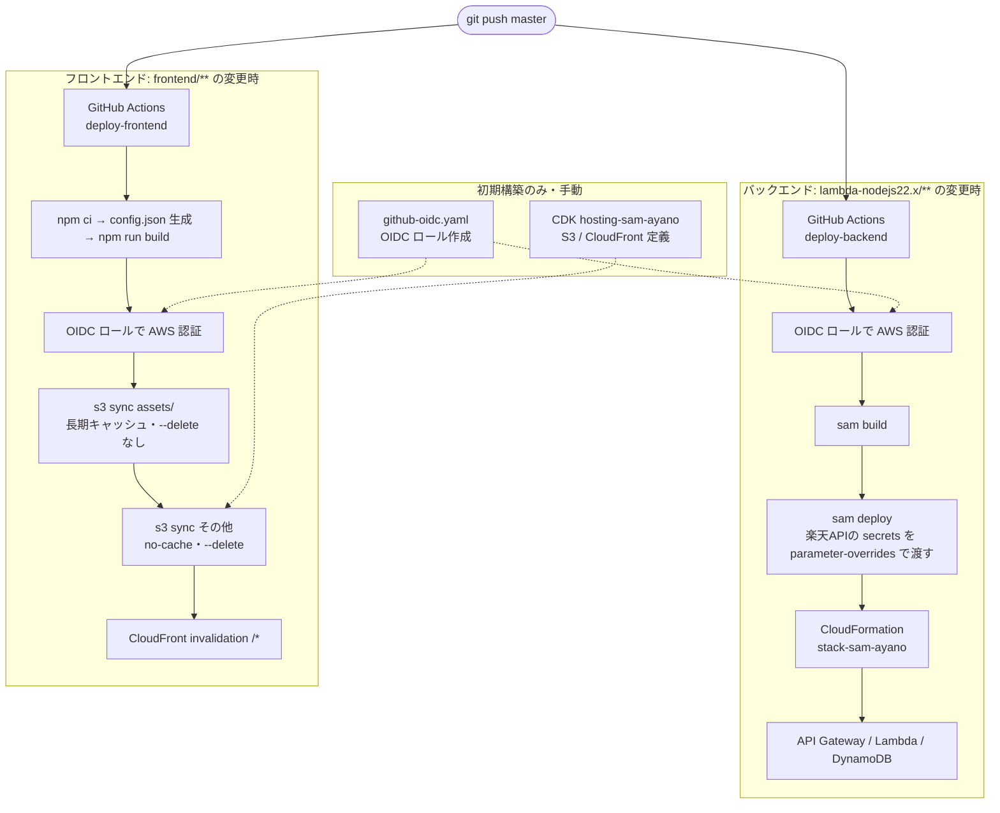

# ツンドク.com

## Description

本のバーコードを読み取るだけで登録可能な、シンプルな書籍管理サービスです。

続き物のマンガや小説など、同じ巻を重複して買うことを防止できます。

## Requirement

- Visual Studio Code
  - AWS Toolkit
- Node.js v22.14.0
- Amazon Web Services
  - CloudFront
  - S3
  - API Gateway
  - Lambda
  - DynamoDB

## Install

このリポジトリをフォークしてクローンします。

```
$ git clone git@github.com:yourname/sam-ayano.git
```

## Usage

`master` にプッシュすると、GitHub Actions が変更のあった側を自動でデプロイします。

- フロントエンド: ビルドして S3 に配置し、CloudFront のキャッシュを削除します
- バックエンド: SAM アプリケーションとしてデプロイします

初回のセットアップ（IAM ロールの作成と GitHub への値の登録）は、`SPECIFICATIONS.md` の「10.3 GitHub Actions のための AWS 設定」を参照してください。

## Deploy Flow



## Contribution

1. このリポジトリをフォークする
2. 変更を加える
3. 変更をコミットする
4. ブランチにプッシュする
5. プルリクエストを作成する

## License

MIT License

## Author

[minato](https://www.minatoproject.com/)
